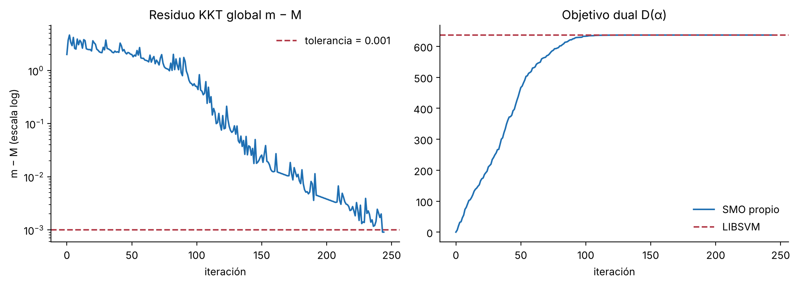
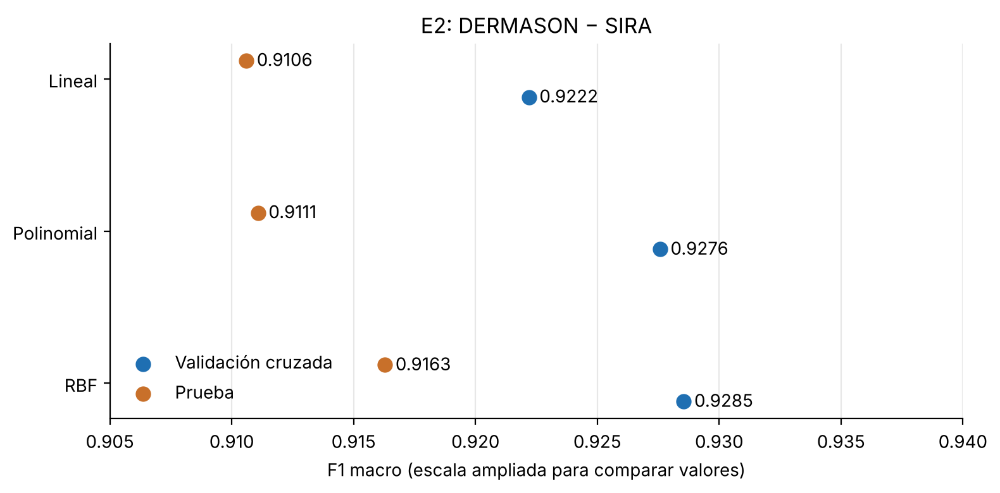
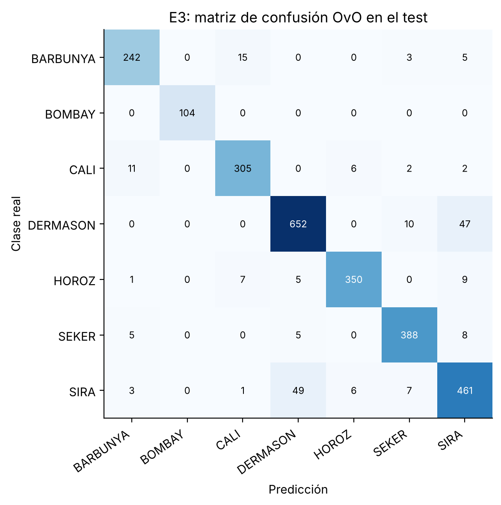
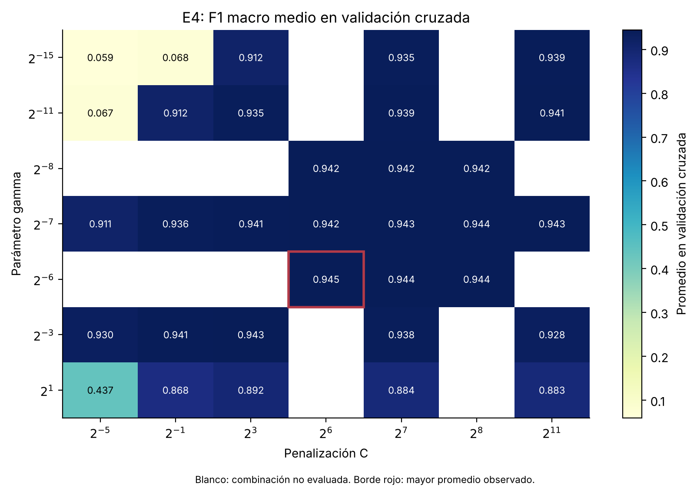
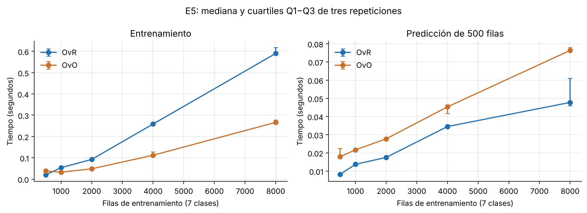
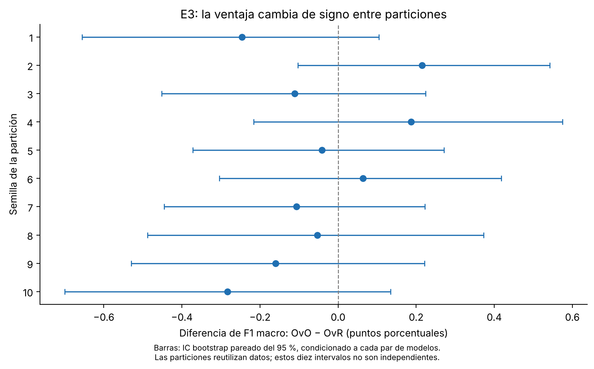

## Resumen

Estudiamos la máquina de vectores soporte (SVM) como un problema de optimización convexa: planteamos el primal de margen blando, derivamos su dual con las condiciones de Karush–Kuhn–Tucker (KKT) y lo resolvemos con el algoritmo de optimización secuencial minimal (SMO), que implementamos desde cero en NumPy. Verificamos la implementación de tres formas: con seis ejemplos resueltos a mano, con 18 pruebas automáticas y comparándola con LIBSVM. Después aplicamos la SVM al conjunto Dry Bean (13 543 granos de siete variedades, 16 medidas geométricas) en cinco experimentos: validación del solver (E1), comparación de kernels en el par de clases más confundido (E2), estrategias multiclase uno contra el resto (OvR) y uno contra uno (OvO) (E3), sensibilidad a los hiperparámetros (E4) y costo computacional (E5).

Nuestro SMO alcanza el mismo objetivo dual que LIBSVM con una diferencia de $9\times10^{-5}$ y un residuo KKT de $9.0\times10^{-4}$. En el par DERMASON–SIRA, el kernel RBF obtiene F1 macro de prueba 0.9163 y supera al lineal en 9 de 10 particiones. En siete clases, OvR y OvO obtienen F1 macro 0.9337 y 0.9350; la diferencia (+0.0012) tiene un intervalo bootstrap del 95 % de $[-0.0030,\,+0.0056]$ y cambia de signo al repetir todo el protocolo con diez particiones nuevas. Concluimos que ambas estrategias son indistinguibles en desempeño y que la diferencia real está en el costo: OvO entrena unas dos veces más rápido con 8 000 filas y predice algo más lento. En el camino encontramos y corregimos un error de nuestro propio solver que declaraba convergencia sin haberla alcanzado; lo documentamos como un ejemplo resuelto a mano.

## 1. Planteamiento del problema y objetivos

### 1.1 El problema

Queremos predecir la variedad de un frijol seco a partir de medidas de su silueta. El conjunto Dry Bean (UCI, DOI 10.24432/C50S4B; Koklu y Ozkan, 2020) contiene 13 611 granos de siete variedades turcas, fotografiados con una cámara de alta resolución y segmentados automáticamente. De cada grano se extrajeron 12 medidas de tamaño (área, perímetro, ejes mayor y menor, excentricidad, área convexa, diámetro equivalente, extensión, solidez, redondez, compacidad y relación de aspecto) y cuatro factores de forma. No trabajamos con las fotografías, sino con esas 16 variables.

Es un problema realista por tres razones. Las clases están desbalanceadas: BOMBAY tiene 522 granos y DERMASON 3 546. Varias variedades se solapan en tamaño y forma, en especial DERMASON y SIRA. Y las variables están fuertemente correlacionadas (el área, el perímetro y el diámetro equivalente miden casi lo mismo), lo que castiga a los modelos que asumen independencia entre variables.

Por el desbalance elegimos **F1 macro** como criterio de selección: promedia el F1 de cada clase con igual peso, de modo que BOMBAY cuenta tanto como DERMASON. Con la exactitud, DERMASON pesaría siete veces más. Informamos también la exactitud para poder comparar con la literatura.

### 1.2 Objetivos

1. Relacionar el problema primal de la SVM, su dual y las condiciones KKT con el algoritmo SMO que implementamos.
2. Verificar el solver con ejemplos de solución conocida, con pruebas automáticas y frente a LIBSVM.
3. Comparar los kernels lineal, polinomial y RBF en el par de clases que más se confunde.
4. Comparar las estrategias multiclase OvR y OvO en desempeño y en costo, y estudiar la sensibilidad a $C$ y $\gamma$.
5. Evaluar si las conclusiones dependen de la partición de los datos.

### 1.3 Alcance

Nuestra implementación de SMO almacena la matriz kernel completa, de tamaño $n \times n$, así que la evaluamos en subconjuntos de algunos cientos de filas. Los experimentos sobre el conjunto completo usan `SVC` de scikit-learn, que envuelve a LIBSVM y resuelve exactamente el mismo problema dual.

## 2. Fundamento matemático

Usamos esta notación: $n$ observaciones $x_i \in \mathbb{R}^d$ con etiquetas $y_i \in \{-1,+1\}$; $\phi$ es el mapa de características (posiblemente implícito); $f(x) = w^T\phi(x) + b$ es la función de decisión; $t_i = y_i f(x_i)$ es el margen funcional del punto $i$; $K(x,z) = \phi(x)^T\phi(z)$ es el kernel.

### 2.1 ¿Por qué maximizar el margen?

Si los datos son separables hay infinitos hiperplanos que los separan. La SVM elige el que deja más espacio entre las clases. La distancia de un punto $x_i$ al hiperplano $w^Tx + b = 0$ es $|f(x_i)|/\|w\|$. Si escalamos $(w, b)$ para que el punto más cercano cumpla $|f| = 1$, el margen geométrico vale $1/\|w\|$ y la franja completa entre las dos clases mide $2/\|w\|$. Maximizar el margen es, entonces, minimizar $\|w\|$:

$$
\min_{w,b}\ \tfrac12\|w\|^2 \quad \text{sujeto a}\quad y_i(w^Tx_i + b) \ge 1,\ i = 1,\dots,n .
$$

Este es el **margen duro**. Funciona solo si los datos son separables.

### 2.2 Margen blando y la función de error

Con datos reales siempre hay puntos del lado equivocado. Permitimos que cada punto viole el margen en una cantidad $\xi_i \ge 0$ y cobramos por ello:

$$
\min_{w,b,\xi}\ P(w,b,\xi) = \tfrac12\|w\|^2 + C\sum_{i=1}^n \xi_i
\quad\text{s.a.}\quad y_i(w^T\phi(x_i)+b) \ge 1-\xi_i,\ \ \xi_i \ge 0 .
$$

En el óptimo cada holgura toma el menor valor que permite la restricción, $\xi_i = \max(0, 1 - t_i)$. Al sustituirla, el problema se convierte en la minimización sin restricciones de la **función de error** del modelo:

$$
E(w,b) = \underbrace{\tfrac12\|w\|^2}_{\text{regularización}} + C\sum_{i=1}^n \underbrace{\max\bigl(0,\,1 - y_i f(x_i)\bigr)}_{\text{pérdida hinge}} .
$$

La pérdida hinge vale cero cuando el punto está del lado correcto y fuera del margen, y crece linealmente cuando lo invade o está mal clasificado. El parámetro $C$ decide cuánto pesa cada error frente al ancho del margen.

**¿Por qué no minimizamos $E$ con descenso del gradiente?** Lo discutimos al inicio del proyecto y lo descartamos por dos razones. Primero, la hinge no es diferenciable en el codo $t_i = 1$; se puede usar un subgradiente (el método Pegasos lo hace), pero la convergencia es lenta y no deja un certificado de que llegamos al óptimo. Segundo, con un kernel no lineal el vector $w$ vive en el espacio de $\phi$, que para el kernel RBF tiene dimensión infinita: ni siquiera podemos escribirlo. El dual resuelve ambos problemas.

### 2.3 Lagrangiano, condiciones KKT y problema dual

Introducimos multiplicadores $\alpha_i \ge 0$ para las restricciones de margen y $\mu_i \ge 0$ para $\xi_i \ge 0$:

$$
\mathcal{L} = \tfrac12\|w\|^2 + C\sum_i \xi_i - \sum_i \alpha_i\bigl[y_i(w^T\phi(x_i)+b) - 1 + \xi_i\bigr] - \sum_i \mu_i \xi_i .
$$

Las condiciones de estacionariedad son:

$$
\frac{\partial \mathcal{L}}{\partial w} = 0 \ \Rightarrow\ w = \sum_i \alpha_i y_i \phi(x_i), \qquad
\frac{\partial \mathcal{L}}{\partial b} = 0 \ \Rightarrow\ \sum_i \alpha_i y_i = 0,
$$
$$
\frac{\partial \mathcal{L}}{\partial \xi_i} = 0 \ \Rightarrow\ C - \alpha_i - \mu_i = 0 .
$$

La tercera, junto con $\mu_i \ge 0$, da la **caja** $0 \le \alpha_i \le C$. Ahora sustituimos en $\mathcal{L}$ y vemos que todo se simplifica. El término $\tfrac12\|w\|^2 - \sum_i \alpha_i y_i w^T\phi(x_i) = \tfrac12 w^Tw - w^Tw = -\tfrac12 w^Tw$. El término con $b$ es $-b\sum_i \alpha_i y_i = 0$. Los términos con $\xi$ se agrupan en $\sum_i (C - \alpha_i - \mu_i)\xi_i = 0$. Queda solo $\sum_i \alpha_i$ y el cuadrático:

$$
\max_{\alpha}\ D(\alpha) = \sum_{i=1}^n \alpha_i - \tfrac12 \sum_{i,j} \alpha_i\alpha_j y_i y_j K(x_i,x_j)
\quad\text{s.a.}\quad 0 \le \alpha_i \le C,\ \ y^T\alpha = 0 .
$$

Tres cosas nos importan de este dual. El mapa $\phi$ desapareció: solo aparece el kernel $K$. Las variables son los $n$ multiplicadores, con restricciones de caja y una sola igualdad lineal. Y como $K$ es semidefinida positiva, $D$ es cóncava: cualquier máximo local es global.

**Condiciones KKT.** Un par $(w,b,\xi)$ y $(\alpha,\mu)$ factibles es óptimo si y solo si cumple la holgura complementaria $\alpha_i[t_i - 1 + \xi_i] = 0$ y $\mu_i \xi_i = 0$. Combinadas con la caja, se leen así:

| Multiplicador | Condición sobre el margen | Interpretación |
|-----|------|---------------|
| $\alpha_i = 0$ | $t_i \ge 1$ | El punto está fuera del margen o justo sobre él; no influye en $w$. |
| $0 < \alpha_i < C$ | $t_i = 1$ | **Soporte libre**: está exactamente sobre el margen. |
| $\alpha_i = C$ | $t_i \le 1$ | Está dentro del margen, sobre él o mal clasificado. |

Estar sobre el margen no obliga a que el multiplicador sea libre: puede ser $0$ o $C$. Esta distinción nos hizo falta en el ejemplo de cinco puntos de la sección 4.3. La dualidad fuerte garantiza además que, en el óptimo, $P = D$; lo comprobamos en cada ejemplo a mano.

Como $w = \sum_i \alpha_i y_i \phi(x_i)$, la función de decisión queda $f(x) = \sum_i \alpha_i y_i K(x_i, x) + b$. Solo los puntos con $\alpha_i > 0$ contribuyen: son los **vectores soporte**.

### 2.4 Qué significa cada parámetro e hiperparámetro

| Símbolo | Qué es | Cómo lo leemos |
|----|--------|------------------------|
| $w, b$ | Parámetros del modelo (se aprenden) | $w$ es la normal al hiperplano; $2/\|w\|$ es el ancho del margen; $b$ desplaza la frontera. Con kernel RBF no vemos $w$, solo $f(x)$. |
| $\alpha_i$ | Multiplicadores de Lagrange (se aprenden) | Miden cuánto "empuja" cada punto a la frontera. $\alpha_i = 0$: no influye. $0<\alpha_i<C$: está sobre el margen. $\alpha_i = C$: viola el margen. En E1 fueron soportes 95 de 400 puntos. |
| $C$ | Hiperparámetro de penalización | $C$ grande: pocos errores tolerados, margen estrecho, riesgo de sobreajuste. $C$ pequeño: margen ancho, más errores, riesgo de subajuste. En el ejemplo 4.3 vemos los cuatro regímenes; en E4, con $C = 2^{-5}$ el F1 cae a 0.06. |
| $\gamma$ (RBF) | Hiperparámetro del kernel | $1/\sqrt{\gamma}$ es el radio de influencia de cada punto. $\gamma$ grande: cada punto solo "ve" a sus vecinos, casi todos se vuelven soportes (más de 5 500 con $\gamma = 2$ en E4) y el modelo memoriza. $\gamma$ pequeño: la frontera se vuelve casi lineal. |
| $p$, $c_0$ (polinomial) | Hiperparámetros del kernel | $p$ es el grado de interacción entre variables; $c_0 = 1$ incluye los términos de grado menor. |
| $\varepsilon$ | Tolerancia del solver | Hasta dónde exigimos el residuo KKT. Con $\varepsilon = 10^{-3}$, $b$ queda determinado solo dentro de un intervalo de ese ancho. |

En Dry Bean, $C$ y $\gamma$ no se eligen por separado: subir $C$ y bajar $\gamma$ tienen efectos parcialmente compensatorios, y por eso el mapa de E4 muestra una diagonal de buen desempeño. Los buscamos juntos en una rejilla de potencias de 2, como recomiendan Hsu, Chang y Lin.

### 2.5 Kernels

Un kernel es una función $K(x,z)$ que equivale a un producto interno $\phi(x)^T\phi(z)$ en algún espacio. Comparamos tres:

$$
K_{\text{lin}}(x,z) = x^Tz, \qquad
K_{\text{pol}}(x,z) = (\gamma x^Tz + c_0)^p, \qquad
K_{\text{RBF}}(x,z) = \exp(-\gamma\|x-z\|^2).
$$

Para entender qué hace el polinomial, escribimos el mapa explícito de $(x^Tz + 1)^2$ en $\mathbb{R}^2$. Con $x = (u,v)$ y $z = (u',v')$:

$$
(uu' + vv' + 1)^2 = u^2u'^2 + v^2v'^2 + 1 + 2uv\,u'v' + 2uu' + 2vv',
$$

que es el producto interno de $\phi(u,v) = (u^2,\ \sqrt2\,uv,\ v^2,\ \sqrt2\,u,\ \sqrt2\,v,\ 1) \in \mathbb{R}^6$. Un hiperplano en $\mathbb{R}^6$ es una cónica en $\mathbb{R}^2$. El kernel RBF corresponde a un mapa de dimensión infinita; por eso solo podemos trabajar con él en el dual.

### 2.6 De dos clases a siete

La SVM es binaria. Para $k$ clases usamos dos descomposiciones:

- **OvR** (uno contra el resto): $k$ clasificadores, cada uno separa una clase de las demás; gana la clase con mayor $f_c(x)$.
- **OvO** (uno contra uno): $k(k-1)/2$ clasificadores, uno por par; cada uno vota por una clase y gana la más votada. Con $k = 7$ son 7 y 21 modelos.

En OvO pueden empatar los votos. Nuestra regla de desempate es **lexicográfica**: primero más votos $v_c$, luego mayor margen acumulado $S_c = \sum_{\text{pares}} \pm f(x)$, y por último el orden de las clases. La escribimos así porque nuestra primera versión usaba $v_c + 10^{-9}S_c$, que no garantiza que los votos dominen cuando los márgenes son grandes. Ejemplo con tres clases A, B, C y un punto $x$: A vence a B con $f = +0.5$, B vence a C con $f = +0.2$ y C vence a A con $f = +0.3$.

| Clase | Votos | Margen acumulado $S_c$ |
|---|---|---|
| A | 1 | $+0.5 - 0.3 = +0.2$ |
| B | 1 | $-0.5 + 0.2 = -0.3$ |
| C | 1 | $-0.2 + 0.3 = +0.1$ |

Los votos empatan y gana A por margen. Con votos $(2,1,0)$ ganaría A aunque B tuviera un margen enorme. Para los experimentos completos usamos `OneVsRestClassifier(SVC)` y `OneVsOneClassifier(SVC)` de scikit-learn, que entrenan de verdad los 7 y 21 modelos. Advertimos que `SVC(decision_function_shape='ovr')` **no** entrena OvR: entrena OvO y solo cambia la forma de la salida.

## 3. El algoritmo SMO

### 3.1 ¿Por qué dos multiplicadores y no uno?

La pregunta que nos hicimos primero fue: ¿por qué no un descenso coordenado, cambiando un $\alpha_i$ a la vez? Porque la restricción $y^T\alpha = 0$ lo impide: si solo cambia $\alpha_i$, entonces $y_i\Delta\alpha_i = 0$ y no hay avance. Con dos multiplicadores $i, j$ podemos movernos a lo largo de la igualdad:

$$
\Delta\alpha_i = s\,y_i, \qquad \Delta\alpha_j = -s\,y_j ,
$$

y $y_i\Delta\alpha_i + y_j\Delta\alpha_j = s - s = 0$ para cualquier $s$. SMO (Platt, 1998) resuelve en cada paso un subproblema de **una** variable, $s$, y lo hace de forma exacta.

### 3.2 El subproblema de un paso

Escribimos el dual en forma matricial con $Q_{ij} = y_iy_jK_{ij}$: $D(\alpha) = \mathbf{1}^T\alpha - \tfrac12\alpha^TQ\alpha$. Su gradiente cambiado de signo es $G = Q\alpha - \mathbf{1}$, y definimos para cada punto $r_i = -y_iG_i$. Al mover el par $(i,j)$ en la dirección anterior, la ganancia dual es una parábola en $s$:

$$
\Delta D(s) = (r_i - r_j)\,s - \tfrac12\,\eta\, s^2, \qquad \eta = K_{ii} + K_{jj} - 2K_{ij} \ge 0 .
$$

($\eta$ es $\|\phi(x_i)-\phi(x_j)\|^2$, por eso no es negativa.) El paso $s$ debe mantener ambos multiplicadores en $[0, C]$; eso da un intervalo factible $[\ell, u]$, intersección de las cuatro cotas de caja. Entonces:

- Si $\eta > 0$: el máximo libre es $s^* = (r_i - r_j)/\eta$ y se recorta a $[\ell, u]$.
- Si $\eta = 0$ y $r_i > r_j$: la ganancia es lineal en $s$ y el máximo está en el extremo $s = u$.

Después del paso actualizamos el gradiente en $O(n)$: $G \leftarrow G + Q_{:,i}\Delta\alpha_i + Q_{:,j}\Delta\alpha_j$. El caso $\eta = 0$ parece académico pero no lo es: ocurre cuando dos observaciones son idénticas, y nuestra primera versión lo manejaba mal (sección 4.4).

### 3.3 Qué par elegir: la pareja de máxima violación

Hay que decidir qué par $(i,j)$ actualizar. Seguimos a Keerthi et al. (2001) y Fan, Chen y Lin (2005): definimos los conjuntos de índices que todavía pueden moverse en cada sentido,

$$
I_{\text{up}} = \{i : y_i = +1,\ \alpha_i < C\} \cup \{i : y_i = -1,\ \alpha_i > 0\},
$$
$$
I_{\text{low}} = \{i : y_i = +1,\ \alpha_i > 0\} \cup \{i : y_i = -1,\ \alpha_i < C\},
$$

y las cantidades $m(\alpha) = \max_{i \in I_{\text{up}}} r_i$ y $M(\alpha) = \min_{j \in I_{\text{low}}} r_j$. El par $(i,j)$ que alcanza $m$ y $M$ es el que más viola las KKT; es el que actualizamos. Y el **residuo KKT global** $m - M$ es nuestro criterio de parada: $\alpha$ es óptimo si y solo si $m - M \le 0$; en la práctica paramos cuando $m - M \le \varepsilon$.

**Relación con la notación de Platt.** Si $E_i = f(x_i) - y_i$ es el error de predicción del punto $i$, un cálculo directo da $G_i = y_i(f(x_i) - b) - 1$ y por tanto

$$
r_i = -y_iG_i = b - E_i .
$$

Así, $m - M = \max_{I_{\text{low}}} E_j - \min_{I_{\text{up}}} E_i$: elegir el par de máxima violación es elegir los dos puntos cuyos errores más se separan en el sentido prohibido por las KKT. Además, en el óptimo el sesgo cumple $M \le b \le m$; por eso $b$ queda fijado solo dentro de un intervalo de ancho $m - M$, y por eso nuestro $b$ difiere del de LIBSVM en unas milésimas cuando $\varepsilon = 10^{-3}$. Tomamos $b$ como la mediana de $r_i$ sobre los soportes libres.

### 3.4 Parada y certificado

Que un algoritmo iterativo se detenga no significa que haya llegado al óptimo. Por eso, al terminar, recalculamos el gradiente desde $\alpha$ (no usamos el acumulado, que puede arrastrar error de redondeo) y declaramos `converged_ = True` solo si se cumplen las cuatro condiciones: $m - M \le \varepsilon$, cajas $0 \le \alpha_i \le C$, $|y^T\alpha|$ a escala de redondeo y todos los valores finitos. Si el bucle se detiene por otro motivo (límite de iteraciones, ningún par mejora), lo registramos como `max_iter` o `stalled`. También guardamos $m - M$ y $D(\alpha)$ en cada iteración para dibujar la convergencia (Figura 1). Conviene no confundir $m - M$ con la brecha de dualidad $P - D$: son dos cantidades distintas, aunque ambas valen cero en el óptimo.

## 4. Ejemplos resueltos a mano

Cada ejemplo de esta sección tiene una prueba automática en `tests/test_smo.py` que verifica el resultado con nuestro SMO y, cuando aplica, con `SVC`.

### 4.1 Margen duro con cuatro puntos

Positivos $(2,0), (2,1)$; negativos $(0,0), (0,1)$. Por simetría la frontera es vertical: $w = (w_1, 0)$. Las restricciones activas $2w_1 + b = 1$ y $b = -1$ dan $w = (1,0)$, $b = -1$, frontera $u = 1$ y margen $2/\|w\| = 2$. El primal vale $P = \tfrac12$. Un certificado dual es $\alpha = (\tfrac14,\tfrac14,\tfrac14,\tfrac14)$: cumple $y^T\alpha = 0$, da $w = \tfrac14[(2,0)+(2,1)-(0,0)-(0,1)] = (1,0)$ y $D = \sum\alpha_i - \tfrac12\|w\|^2 = 1 - \tfrac12 = \tfrac12 = P$. Los cuatro puntos son soportes y están sobre el margen ($t_i = 1$).

### 4.2 Un paso de SMO, completo

Datos en una dimensión: $x_1 = 1$, $y_1 = +1$; $x_2 = -1$, $y_2 = -1$; kernel lineal; $C = 1$. Entonces $K = \begin{pmatrix}1&-1\\-1&1\end{pmatrix}$ y $Q = \begin{pmatrix}1&1\\1&1\end{pmatrix}$.

| Paso | Qué hace el algoritmo | Cálculo |
|-----|---------------|-----------|
| 0. Inicio | $\alpha = (0,0)$; $G = Q\alpha - \mathbf 1 = (-1,-1)$; $r_i = -y_iG_i$ | $r = (1, -1)$ |
| 1. Conjuntos | $I_{\text{up}} = \{1\}$ ($y=+1$, $\alpha<C$); $I_{\text{low}} = \{2\}$ ($y=-1$, $\alpha<C$) | $m = r_1 = 1$, $M = r_2 = -1$ |
| 2. ¿Parar? | $m - M = 2 > \varepsilon$ | No. Par $(i,j) = (1,2)$ |
| 3. Curvatura | $\eta = K_{11} + K_{22} - 2K_{12}$ | $\eta = 1 + 1 + 2 = 4$ |
| 4. Intervalo factible | $\Delta\alpha_1 = s \in [0,1]$; $\Delta\alpha_2 = s \in [0,1]$ | $[\ell,u] = [0,1]$ |
| 5. Paso | $s^* = (m-M)/\eta$, recortado a $[\ell,u]$ | $s^* = 2/4 = \tfrac12$ (dentro) |
| 6. Actualizar | $\alpha \leftarrow (\tfrac12,\tfrac12)$; $G \leftarrow G + \tfrac12 Q_{:,1} + \tfrac12 Q_{:,2}$ | $G = (0,0)$ |
| 7. Ganancia dual | $\Delta D = (m-M)s - \tfrac12\eta s^2$ | $1 - \tfrac12 = \tfrac12$ |
| 8. Nuevos conjuntos | Ambos índices están ahora en $I_{\text{up}}$ y en $I_{\text{low}}$ | $r = (0,0)$: $m - M = 0$, **parar** |
| 9. Sesgo | Mediana de $r_i$ sobre los soportes libres | $b = 0$ |
| 10. Resultado | $w = \sum\alpha_iy_ix_i = \tfrac12 + \tfrac12 = 1$; $D = \sum\alpha - \tfrac12\alpha^TQ\alpha$ | $f(x) = x$; $D = 1 - \tfrac12 = \tfrac12 = P$ |

Podemos comprobarlo sin SMO: la igualdad dual obliga a $\alpha_1 = \alpha_2 = a$, así que $D(a) = 2a - 2a^2$, máximo en $a = \tfrac12$. Una sola actualización resolvió el problema porque el máximo libre cayó dentro del intervalo factible. Con 400 puntos (E1) hicieron falta 244.

### 4.3 Cómo $C$ mueve la frontera: cinco puntos

Añadimos al ejemplo 4.1 un quinto punto positivo $x_5 = (\tfrac12, 0)$, que queda del lado de los negativos. Ahora el margen duro no es gratis: separar a $x_5$ exige una frontera en $u \in (0, \tfrac12)$ y una norma grande. Resolvimos el problema **para todo $C$** con las KKT y verificamos cada tramo con `SVC` y con nuestro SMO (prueba `test_hand_example_soft_margin_path_in_C`). La frontera es $w_1 u + b = 0$; en todos los tramos $w_2 = 0$, lo que justificamos con el certificado dual, no por simetría (el quinto punto la rompe).

| Tramo | $w_1^*$ | $b^*$ | Frontera $u^*$ | $\alpha^*$ (orden $x_1..x_5$) | $P(C) = D(C)$ | Situación de $x_5$ |
|------|---|---|-----|---------|------|--------------|
| $0 < C \le 2/5$ | $5C/2$ | $1 - 5C$ | $2 - 2/(5C)$ | $(0, C, C, C, C)$ | $4C - 25C^2/8$ | mal clasificado si $C > 4/15$; para $C < 1/5$ el modelo predice todo positivo |
| $2/5 \le C \le 2$ | $1$ | $-1$ | $1$ | $(0, \tfrac{2-C}{4}, C, \tfrac{2-C}{4}, C)$ | $\tfrac12 + 3C/2$ | mal clasificado, $\xi_5 = 3/2$ |
| $2 \le C \le 8$ | $C/2$ | $-1$ | $2/C$ | $(0, 0, C, 0, C)$ | $2C - C^2/8$ | sobre la frontera en $C = 4$; bien clasificado dentro del margen si $C > 4$ |
| $C \ge 8$ | $4$ | $-1$ | $1/4$ | $(0, 0, 8, 0, 8)$ | $8$ | sobre el margen, $\xi_5 = 0$ (margen duro) |

**Verificación del tramo $2 \le C \le 8$, que es el que hacemos en pizarra.** Con $\alpha = (0,0,C,0,C)$ se cumplen las cajas y $y^T\alpha = -C + C = 0$. La estacionariedad da $w = -C(0,0) + C(\tfrac12,0) = (C/2, 0)$. Con $b = -1$ los márgenes son $t = (C-1,\ C-1,\ 1,\ 1,\ C/4 - 1)$. Los dos primeros tienen $\alpha = 0$ y necesitan $t \ge 1$: se cumple si $C \ge 2$. El tercero tiene $\alpha = C$ y $t = 1$: permitido. El cuarto tiene $\alpha = 0$ y $t = 1$: permitido (sobre el margen, pero no libre). El quinto tiene $\alpha = C$ y necesita $t \le 1$: se cumple si $C \le 8$. La única holgura positiva es $\xi_5 = 2 - C/4$, así que $P = \tfrac12(C/2)^2 + C(2 - C/4) = 2C - C^2/8$, y $D = \sum\alpha - \tfrac12\|w\|^2 = 2C - C^2/8$. Coinciden. Si hubiéramos repartido $\alpha_3 = \alpha_4 = C/2$ "por simetría", $w$ tendría segunda componente $-C/2$ y el certificado fallaría.

**Lectura.** Con $C$ muy pequeño ($< 1/5$) el modelo se rinde: predice todo positivo porque la norma pequeña vale más que clasificar bien a los negativos. Al crecer $C$, la frontera avanza desde $u = 1$ hasta $u = 1/4$ y en $C = 4$ pasa exactamente por $x_5$. Para $C \ge 8$ recuperamos el margen duro. El mismo conjunto de datos produce cuatro clasificadores distintos según cuánto cueste equivocarse.

### 4.4 Lo que encontramos al implementar: curvatura nula y parada prematura

Este ejemplo salió de un error nuestro. Tomemos kernel lineal, $C = 1$, $X = (0, 0, 2)^T$ y $y = (-1, +1, -1)^T$: los dos primeros puntos son idénticos con etiquetas opuestas. La matriz kernel es $K = \mathrm{diag}(0,0,4)$ y la igualdad dual da $\alpha_2 = \alpha_1 + \alpha_3 \le 1$. Sustituyendo,

$$
D = \alpha_1 + \alpha_2 + \alpha_3 - \tfrac12\cdot 4\alpha_3^2 = 2\alpha_1 + 2\alpha_3 - 2\alpha_3^2 ,
$$

con $\alpha_1 + \alpha_3 \le 1$. Para un $\alpha_3$ dado conviene $\alpha_1 = 1 - \alpha_3$, y entonces $D = 2 - 2\alpha_3^2$, máximo en $\alpha^* = (1, 1, 0)$ con $D^* = 2$. Resulta $w = 0$; las KKT del primer punto ($\alpha = C$, $y = -1$) exigen $b \ge -1$ y las del tercero ($\alpha = 0$, $y = -1$) exigen $b \le -1$, así que $b^* = -1$. El modelo predice $-1$ para todo, y el punto 2 queda mal clasificado: es inevitable, porque es idéntico al punto 1.

**Qué hacía nuestra primera versión.** El par de máxima violación es $(1, 2)$, con $\eta = 0$. El código lo descartaba por "curvatura degenerada", actualizaba otro par, llegaba a $\alpha = (0, \tfrac12, \tfrac12)$ con $D = 0.5$ y $m - M = 2$, y aun así marcaba `converged_ = True`, porque la bandera se decidía por "no hay más pares que actualizar" y no por el residuo global.

**Qué hace ahora.** Con $\eta = 0$ la ganancia es lineal y toma el extremo $s = u$. El resultado es $\alpha = (1,1,0)$, $b = -1$, $D = 2$, $m - M = 0$ y `termination_reason_ = "converged"`. Coincide con el cálculo a mano y con LIBSVM. La lección que nos llevamos: **que el algoritmo se detenga no certifica optimalidad; hay que medir el residuo KKT global con todos los índices.**

### 4.5 Kernel polinomial y votación OvO

El mapa explícito de $(x^Tz+1)^2$ está en la sección 2.5 y el ejemplo de votación con empate en la sección 2.6. Ambos tienen prueba automática (`test_ovo_lexicographic_tie_break_table7` incluye además un caso en que los márgenes son de orden $10^{12}$ y la regla antigua $v + 10^{-9}S$ habría elegido mal).

## 5. Implementación y pruebas

Implementamos `SMOBinary` (kernels lineal, polinomial y RBF; pareja de máxima violación; parada por $m - M$) y los envoltorios `SMOOneVsRest` y `SMOOneVsOne` en `src/smo.py`, unas 300 líneas de NumPy. El protocolo experimental está en `src/experiments.py` y se ejecuta con `run_experiments.py`; el remuestreo con diez particiones, con `run_seeds.py`.

Durante el Hito II corregimos tres cosas de nuestra primera versión: el tratamiento de $\eta = 0$ y la bandera de convergencia (sección 4.4); el historial de convergencia, que guardaba la diferencia $r_i - r_j$ del par actualizado en lugar del residuo global $m - M$ (la figura del Hito I estaba mal rotulada); y el desempate OvO (sección 2.6). Añadimos además el objetivo dual por iteración, una medida de violación KKT puntual con el $b$ devuelto, un bootstrap pareado para E3, el registro del entorno de cada corrida y una caché de la búsqueda de hiperparámetros que se valida con una huella de los datos, la rejilla, la semilla y las versiones instaladas.

| Prueba | Qué verifica |
|-----------|----------|
| `test_binary_agrees_with_libsvm` (×3 kernels) | Residuo KKT $\le 2\times10^{-3}$, igualdad dual y $\ge 98\,\%$ de concordancia con `SVC`. |
| `test_explicit_multiclass_wrappers` | OvR y OvO propios en tres clases sintéticas. |
| `test_hand_example_hard_margin_four_points` | Ejemplo 4.1: $w = (1,0)$, $b = -1$, $D = \tfrac12$. |
| `test_hand_example_smo_two_points` | Ejemplo 4.2: $\alpha = (\tfrac12,\tfrac12)$, $b = 0$, residuo $2 \to 0$. |
| `test_hand_example_soft_margin_path_in_C` (×5 valores de $C$) | Ejemplo 4.3: los cuatro tramos, con SMO propio y `SVC`. |
| `test_degenerate_pair_with_zero_curvature` | Ejemplo 4.4: $\alpha = (1,1,0)$, $D = 2$, convergencia certificada. |
| `test_small_positive_curvature_keeps_quadratic_solution` (×2) | $\eta = 10^{-16}$ sin división inestable. |
| `test_skipped_small_step_does_not_certify_convergence` | Un paso omitido no produce `converged_`. |
| `test_iteration_limit_does_not_certify_convergence` | Agotar `max_iter` no certifica. |
| `test_ovo_lexicographic_tie_break_table7` | Tabla de la sección 2.6 y el caso de márgenes enormes. |
| `test_global_history_ends_at_certified_residual` | El historial termina en $m - M \le \varepsilon$ y $D(\alpha)$ nunca decrece. |

**Total: 18 pruebas, 18 pasan** (`python -m pytest -q`).

## 6. Datos y protocolo experimental

Los datos tienen 13 611 filas y 16 variables, sin valores faltantes. Encontramos 68 filas duplicadas exactas, todas de HOROZ, y las eliminamos **antes** de particionar, para que ninguna copia caiga a la vez en entrenamiento y prueba. Quedan 13 543 observaciones.

**Partición principal.** Estratificada 80/20 con semilla 42: 10 834 filas de entrenamiento y 2 709 de prueba. El test se consulta una sola vez, al final, para las métricas de E2 y E3.

**Selección de hiperparámetros.** Validación cruzada estratificada de 5 pliegues dentro del entrenamiento. El `StandardScaler` se ajusta dentro de cada pliegue, en un `Pipeline`, para no filtrar información. La búsqueda RBF es en dos etapas: una rejilla gruesa de potencias de 2 ($C \in \{2^{-5}, 2^{-1}, 2^3, 2^7, 2^{11}\}$, $\gamma \in \{2^{-15}, 2^{-11}, 2^{-7}, 2^{-3}, 2^{1}\}$, 25 combinaciones) y un refinamiento con los exponentes vecinos del mejor punto (9 combinaciones). Para los kernels lineal y polinomial usamos $C \in \{2^{-5}, 2^{-1}, 2^3, 2^7\}$ y, en el polinomial, grado $p \in \{2, 3\}$ con $c_0 = 1$.

**Elección del par binario (E2).** Entrenamos el mejor RBF multiclase con predicciones fuera de pliegue (OOF) sobre el entrenamiento y elegimos el par de clases con más confusiones. El test no interviene.

**Comparación OvR frente a OvO (E3).** Ambas estrategias usan la misma configuración RBF elegida por CV. Para medir la incertidumbre de la diferencia de F1 macro usamos un **bootstrap pareado**: 2 000 remuestreos del test, con los mismos índices para las dos estrategias y sin reentrenar.

**Diez particiones adicionales.** El test de la semilla 42 ya lo habíamos consultado en el Hito I, así que repetirlo no es una evaluación independiente. Elegimos las semillas 1 a 10 antes de ver sus resultados y repetimos **todo** el protocolo en cada una: partición, búsqueda RBF en dos etapas, selección del par por OOF, búsqueda de los tres kernels y comparación OvR/OvO con bootstrap. Las diez particiones reutilizan el mismo conjunto de datos, así que no son independientes entre sí; miden la sensibilidad de las conclusiones a la partición, no las validan con datos nuevos.

**Entorno.** Las cifras de las secciones 7.1 a 7.6 provienen de una corrida en Linux con Intel Xeon a 2.10 GHz, 2 núcleos lógicos y 7.8 GB de RAM, con Python 3.13.18, NumPy 2.5.3, pandas 3.0.5, scikit-learn 1.9.1 y SciPy 1.18.1 (`results/environment.json`). Repetimos la corrida completa en otra máquina con 4 núcleos y las mismas versiones: todas las métricas coincidieron exactamente; solo cambiaron los tiempos de E5 (Anexo A).

## 7. Resultados

### 7.1 E1: nuestro SMO frente a LIBSVM

Usamos 400 filas de entrenamiento del par DERMASON–SIRA, kernel RBF con $C = 8$ y $\gamma = 2^{-8}$, tolerancia $10^{-3}$ para nuestro SMO y $10^{-6}$ para LIBSVM.

| Indicador | SMO propio | LIBSVM |
|---|---|---|
| Objetivo dual $D(\alpha)$ | 636.552759 | 636.552849 |
| $\lvert D_{\text{propio}} - D_{\text{LIBSVM}}\rvert$ | $9.0\times10^{-5}$ | — |
| Iteraciones / motivo de parada | 244 / `converged` | — |
| Residuo KKT global $m - M$ | $9.04\times10^{-4} \le \varepsilon$ | — |
| Máxima violación KKT puntual (con el $b$ devuelto) | $5.5\times10^{-4}$ | — |
| Cajas: $\min\alpha$, $\max\alpha - C$ | $0$, $0$ | — |
| $\lvert y^T\alpha\rvert$ | $1.8\times10^{-15}$ | — |
| Sesgo $b$ | $-1.9074$ | $-1.9105$ |
| Máx. $\lvert f_{\text{propio}} - f_{\text{LIBSVM}}\rvert$ | 0.00176 | — |
| Concordancia de predicciones | 1.0000 | — |
| Vectores soporte | 95 | 95 |



**Qué mirar en la Figura 1.** El residuo no baja de forma monótona: cada paso corrige al par elegido pero cambia el gradiente de todos los demás puntos. Lo que sí sube en cada paso es $D(\alpha)$, que alcanza el valor de LIBSVM hacia la iteración 100; las 140 iteraciones restantes sirven para bajar el residuo hasta $\varepsilon$. La diferencia de sesgo (0.003) es coherente con $\varepsilon = 10^{-3}$: $b$ solo queda determinado dentro de un intervalo de ancho $m - M$ (sección 3.3). Los dos solvers eligen los mismos 95 vectores soporte y predicen igual en los 400 puntos.

Los envoltorios OvR y OvO propios, en un subconjunto de 420 filas de entrenamiento y 210 de prueba con $C = 8$ y $\gamma = 2^{-6}$, obtienen F1 macro 0.9305 (7 de 7 modelos convergidos) y 0.9317 (21 de 21), con residuo máximo $2\times10^{-3}$.

### 7.2 Selección del par binario

| Par | Confusiones OOF |
|---|---|
| **DERMASON–SIRA** | **348** |
| BARBUNYA–CALI | 72 |
| DERMASON–SEKER | 66 |
| HOROZ–SIRA | 62 |

DERMASON–SIRA concentra casi cinco veces más confusiones que el segundo par (146 DERMASON predichos como SIRA y 202 al revés). En las diez particiones adicionales salió elegido siempre, con entre 340 y 364 confusiones: la elección no depende de la partición.

### 7.3 E2: kernels en DERMASON–SIRA

Con 4 946 filas de entrenamiento y 1 236 de prueba:

| Kernel | Configuración elegida por CV | F1 macro CV | F1 macro prueba | Exactitud prueba | Soportes |
|---|---|---|---|---|---|
| Lineal | $C = 2^7$ | 0.9222 | 0.9106 | 0.9126 | 911 |
| Polinomial | $C = 2^{-1}$, $p = 3$ | 0.9276 | 0.9111 | 0.9134 | 873 |
| RBF | $C = 2^7$, $\gamma = 2^{-8}$ | 0.9285 | **0.9163** | 0.9183 | 858 |



En las diez particiones adicionales, el F1 de prueba medio fue 0.9175 para el lineal, 0.9201 para el polinomial y 0.9212 para RBF. **RBF supera al lineal en 9 de 10 particiones** (diferencia media +0.0038) y al polinomial en 7 de 10.

**Qué concluimos.** La no linealidad aporta poco, pero de forma consistente. El par se separa casi linealmente en las 16 medidas, y el error que queda (unos 100 granos de 1 236) parece solapamiento real entre dos variedades de tamaño y forma parecidos, no falta de flexibilidad del modelo: los tres kernels se equivocan casi en los mismos puntos.

### 7.4 E3: OvR frente a OvO con configuración común

Configuración RBF elegida por CV sobre las siete clases: $C = 64$, $\gamma = 2^{-6}$.

| Estrategia | Modelos | F1 macro | Exactitud | Suma de soportes | Entrenamiento (s) | Predicción de 2 709 filas (s) |
|---|---|---|---|---|---|---|
| OvR | 7 | 0.9337 | 0.9225 | 4 038 | 1.42 | 0.39 |
| OvO | 21 | 0.9350 | 0.9236 | 2 416 | 0.43 | 0.45 |

Una misma observación puede contarse como soporte en varios clasificadores.

| Clase | Filas de prueba | F1 OvR | F1 OvO |
|---|---|---|---|
| BARBUNYA | 265 | 0.915 | 0.918 |
| BOMBAY | 104 | 1.000 | 1.000 |
| CALI | 326 | 0.932 | 0.933 |
| DERMASON | 709 | 0.919 | 0.918 |
| HOROZ | 372 | 0.955 | 0.954 |
| SEKER | 406 | 0.945 | 0.951 |
| SIRA | 527 | 0.870 | 0.871 |



**Incertidumbre.** La diferencia de F1 macro OvO − OvR es +0.0012, con intervalo bootstrap percentil del 95 % $[-0.0030, +0.0056]$ y desviación bootstrap 0.0022; en el 28.7 % de las réplicas la diferencia es menor o igual que cero. Las dos estrategias predicen lo mismo en 2 670 de 2 709 filas. De las 39 discrepancias, solo OvR acierta en 16 y solo OvO en 19: la "ventaja" de OvO son tres granos.

### 7.5 E4: sensibilidad a $C$ y $\gamma$



- **Hay una meseta, no un punto.** Las cuatro mejores configuraciones ($C \in \{64, 128, 256\}$, $\gamma \in \{2^{-7}, 2^{-6}\}$) tienen F1 macro CV entre 0.9441 y 0.9448. Su desviación entre pliegues es de unas 0.005, siete veces la separación entre ellas. Hay 14 de 33 configuraciones con F1 $\ge 0.940$.
- **Los bordes fallan de formas distintas.** Con $C = 2^{-5}$ y $\gamma$ muy pequeño, el F1 cae a 0.06: el modelo predice una sola clase y casi todo el entrenamiento son soportes (10 648 de 10 834). Con $\gamma = 2$ hay más de 5 500 soportes para cualquier $C$: cada punto solo ve a sus vecinos inmediatos. En la meseta hay entre 1 750 y 1 850.
- **Las diez particiones confirman la meseta.** La $C$ elegida varió entre 128 y 4 096 según la semilla, con un F1 de CV casi idéntico (0.9411 a 0.9440). Elegir "el mejor" punto exacto es arbitrario; lo robusto es la región.

### 7.6 E5: costo computacional

Variamos el número de filas de entrenamiento con las siete clases, tres repeticiones y un lote fijo de 500 filas para predecir. Mediana [Q1, Q3] en segundos, en la máquina de 2 núcleos:

| Filas | Entrenamiento OvR | Entrenamiento OvO | Predicción OvR | Predicción OvO |
|---|---|---|---|---|
| 500 | 0.020 [0.019, 0.020] | 0.038 [0.032, 0.039] | 0.008 | 0.018 |
| 1 000 | 0.053 [0.052, 0.057] | 0.032 [0.032, 0.034] | 0.014 | 0.022 |
| 2 000 | 0.092 [0.092, 0.093] | 0.048 [0.048, 0.049] | 0.018 | 0.028 |
| 4 000 | 0.258 [0.257, 0.259] | 0.112 [0.110, 0.128] | 0.034 | 0.045 |
| 8 000 | 0.590 [0.590, 0.618] | 0.266 [0.266, 0.278] | 0.048 | 0.076 |



Ajustamos $\log T = \log c + \theta \log n$ sobre las medianas:

| Estrategia | $\theta$ (500 a 8 000) | $R^2$ | $\theta$ (1 000 a 8 000) | $R^2$ |
|---|---|---|---|---|
| OvR | 1.21 | 0.994 | 1.19 | 0.987 |
| OvO | 0.74 | 0.844 | 1.03 | 0.976 |

Al variar el número de clases $k$ con 700 filas fijas, OvO entrena más rápido para todo $k$ de 2 a 7 (con $k = 7$: 0.026 s frente a 0.029 s) y la ventaja se reduce al crecer $k$.

**Qué concluimos.**

1. **OvO entrena 2.2 veces más rápido con 8 000 filas** aunque tenga tres veces más modelos. Cada modelo OvO usa unas $2n/k$ filas; si el costo por modelo crece como $n^\theta$ con $\theta > 1$, conviene resolver muchos problemas pequeños antes que pocos grandes. Con $n = 500$ la relación se invierte (OvO tarda el doble): el costo fijo de crear 21 modelos domina.
2. **OvO predice más lento**: 21 evaluaciones de kernel contra 7. Si la aplicación entrena una vez y predice millones de veces, la ventaja cambia de lado.
3. **$\theta$ describe este rango y esta máquina**, no la complejidad del algoritmo. El de OvO depende de si incluimos $n = 500$ (0.74 frente a 1.03); por eso reportamos ambos. En otra máquina los tiempos absolutos cambiaron (Anexo A) y las relaciones se mantuvieron.

### 7.7 ¿Las conclusiones dependen de la partición?

| Métrica (10 particiones) | Media | DE | Mín. | Máx. |
|---|---|---|---|---|
| F1 macro CV del mejor RBF | 0.9422 | 0.0009 | 0.9411 | 0.9440 |
| E3: F1 macro prueba OvR | 0.9443 | 0.0043 | 0.9376 | 0.9505 |
| E3: F1 macro prueba OvO | 0.9438 | 0.0048 | 0.9348 | 0.9520 |
| **OvO − OvR** | **−0.0005** | 0.0017 | −0.0028 | +0.0021 |
| E2: F1 prueba RBF binario | 0.9212 | 0.0077 | 0.9104 | 0.9386 |



OvO supera a OvR en 3 de las 10 particiones y los diez intervalos bootstrap contienen al cero. Con nuestra partición original OvO parecía ligeramente mejor (+0.0012); al repetir todo con diez particiones la diferencia cambió de signo y su media fue −0.0005. No presentamos una prueba t sobre las diez diferencias porque las particiones comparten datos y no son independientes; el cambio de signo basta para no declarar un ganador. Cada partición costó unos 161 s en 2 núcleos.

## 8. Discusión

| Afirmación | ¿Se sostiene? | Evidencia |
|---------|------|--------------|
| Nuestro SMO resuelve el mismo dual que LIBSVM | Sí, dentro de $\varepsilon$ | E1: $\lvert\Delta D\rvert = 9\times10^{-5}$, KKT global y puntual $\le \varepsilon$, mismos 95 soportes, concordancia 1.0 |
| La bandera de convergencia es un certificado | Sí, tras la corrección | Ejemplo 4.4 y cuatro pruebas de "no certificación" |
| RBF es mejor que el lineal en DERMASON–SIRA | Sí, con efecto pequeño | +0.0038 de media; 9 de 10 particiones |
| OvO clasifica mejor que OvR | **No** | Intervalo que contiene al 0 en la partición original; signo variable en 10 particiones |
| OvO entrena más rápido que OvR | Sí, en este rango y equipo | 2.2 veces con 8 000 filas; menor en todo $k$; se invierte con 500 filas |
| Existe un $(C,\gamma)$ óptimo bien definido | No; existe una región | Meseta en E4; $C$ elegida de 128 a 4 096 según la partición |
| $\theta$ mide la complejidad del algoritmo | No | Describe 500 a 8 000 filas en una máquina; sensible al costo fijo |

Lo que más nos enseñó el proyecto no fue un número sino dos correcciones. Nuestra primera versión del SMO descartaba los pares con curvatura nula y aun así declaraba convergencia. Lo descubrimos construyendo a mano un caso de tres puntos con dos observaciones idénticas: el dual óptimo vale 2 y el código se detenía en 0.5. Corregimos el paso, hicimos que la bandera de convergencia dependiera solo del residuo global y escribimos una prueba por cada ejemplo del informe. Algo parecido pasó con "OvO es mejor que OvR": en el Hito I lo habíamos escrito a partir de una sola partición; la ventaja desapareció en cuanto medimos su incertidumbre.

**Limitaciones.** Las diez particiones reutilizan el mismo conjunto de datos y no sustituyen a una validación con datos externos. Comparamos OvR y OvO con una configuración común, elegida para el problema multiclase; ajustar $(C,\gamma)$ por separado para cada estrategia podría cambiar las cifras absolutas (aunque no esperamos que cambie la conclusión, dada la meseta). El bootstrap mide la incertidumbre por muestreo del test, no la del entrenamiento. Los tiempos de E5 dependen de la máquina y de tres repeticiones. Y el F1 de prueba de E2 y E3 en la partición 42 lleva algo de sesgo optimista, porque la pareja binaria y los hiperparámetros se eligieron, aunque sin tocar el test, con el mismo entrenamiento.

## 9. Fortalezas y desventajas de la SVM

**Fortalezas**

- Es un problema **convexo**: no hay mínimos locales y las KKT certifican la solución. Lo vimos en E1: dos solvers distintos llegan al mismo objetivo.
- El **truco del kernel** permite fronteras no lineales sin construir $\phi$. Con RBF ganamos F1 frente al lineal de forma consistente.
- La solución es **dispersa**: solo los vectores soporte importan. En la meseta de E4 son unos 1 800 de 10 834 puntos.
- La regularización está incorporada ($C$) y funciona bien con pocas muestras y muchas variables.
- Pocos hiperparámetros: uno para el margen y uno o dos para el kernel. La rejilla base 2 es manejable.

**Desventajas**

- **Costo de entrenamiento** entre $O(n^2)$ y $O(n^3)$ en el peor caso, y memoria $O(n^2)$ si se guarda el kernel completo. Por eso nuestro SMO solo corre en subconjuntos y LIBSVM necesita caché y *shrinking*. En E5 el tiempo creció con exponente empírico 1.2.
- **No es multiclase de forma nativa**: hay que descomponer en 7 o 21 modelos, cada uno con su costo.
- **No produce probabilidades**: la salida es una distancia con signo; calibrarla (escalamiento de Platt) exige otro ajuste.
- **Sensible a la escala** de las variables: sin estandarizar, $\gamma$ pierde sentido.
- **Sensible a $(C,\gamma)$** fuera de la meseta: en los bordes de E4 el F1 cae a 0.06.
- **Poco interpretable con kernels no lineales**: no hay un coeficiente por variable como en una regresión logística.
- **Clases desbalanceadas**: optimiza implícitamente el total de errores. Usamos F1 macro para seleccionar, y aun así SIRA es la clase con peor F1 (0.87).

## 10. Usos actuales en el ámbito profesional

Aunque las redes profundas dominan hoy las imágenes y el texto crudo, la SVM sigue siendo una herramienta de primera línea cuando los datos son **tabulares, de tamaño moderado y con pocas muestras por clase**, que es exactamente el caso de Dry Bean.

- **Agroindustria y control de calidad.** El trabajo original de Dry Bean (Koklu y Ozkan, 2020) obtuvo su mejor exactitud (93.1 %) con SVM frente a árboles de decisión, k vecinos y redes multicapa. Clasificar granos, semillas y frutos a partir de medidas de forma extraídas por visión artificial es un uso industrial habitual.
- **Bioinformática.** Clasificación de tejidos a partir de expresión génica, con miles de variables y decenas de muestras, y selección de genes con SVM-RFE (Guyon et al., 2002).
- **Teledetección.** Clasificación de cobertura del suelo en imágenes satelitales multiespectrales; es uno de los clasificadores de referencia en la revisión de Mountrakis, Im y Ogole (2011).
- **Texto y correo.** Categorización de documentos y filtrado de spam, con representaciones dispersas de alta dimensión (Joachims, 1998). La variante lineal (LIBLINEAR) escala a millones de documentos.
- **Finanzas.** Calificación crediticia y detección de fraude sobre tablas de clientes (Huang et al., 2004).
- **Diagnóstico médico.** Clasificación de señales (EEG, ECG) y de biomarcadores en estudios con pocas decenas de pacientes.
- **Infraestructura de software.** `SVC` de scikit-learn (sobre LIBSVM) y `LinearSVC` (sobre LIBLINEAR) están en producción en incontables sistemas y son la línea base contra la que se comparan modelos nuevos.

En todos estos casos la razón es la que vimos en el proyecto: problema convexo, certificado de optimalidad, pocas decisiones de diseño y buen desempeño con datos limitados.

## 11. Conclusiones y trabajo futuro

1. La SVM de margen blando es un programa cuadrático convexo cuyo dual se resuelve con SMO. Nuestro solver, corregido, alcanza el objetivo de LIBSVM con una diferencia de $9\times10^{-5}$ y certifica la solución con el residuo KKT global.
2. Los seis ejemplos a mano, todos verificados con pruebas, muestran el margen, el efecto de $C$ (cuatro tramos de la solución), un paso de SMO, el kernel polinomial, el desempate multiclase y un caso degenerado en el que detenerse no implica optimalidad.
3. En Dry Bean, el par más confundido es DERMASON–SIRA en las once particiones examinadas. RBF mejora levemente y de forma consistente al kernel lineal.
4. OvR y OvO no se distinguen en F1 macro (unos 0.944 de media en diez particiones). OvO entrena unas dos veces más rápido y predice algo más lento.
5. El buen desempeño ocupa una región amplia de $(C,\gamma)$, no un punto.

**Trabajo futuro.** Ajustar $(C,\gamma)$ por separado para cada estrategia multiclase; usar validación cruzada anidada para estimar el desempeño sin sesgo de selección; añadir caché de columnas del kernel para escalar nuestro SMO más allá de unos miles de filas; probar la selección de pares de segundo orden (WSS2 de Fan et al.); y usar `class_weight='balanced'` para mejorar SIRA.

## 12. Contribución de cada integrante

| Integrante | Secciones del informe | Código y experimentos |
|------|--------|--------------|
| Leonardo Panduro | 2.3, 3, 4.4, 5 | `src/smo.py`, corrección de curvatura nula y convergencia, pruebas |
| Diego Godoy | 2.1, 2.2, 4.1, 4.3 | Verificación con `SVC` del camino de la solución en $C$ |
| Nayara Sernaqué | 1, 6, 7.7 | `run_seeds.py`, protocolo de diez particiones |
| Sebastian Arriaran | 7.1, 7.3, 7.5, 4.2 | `experiments.py`: E1, E2, E4 |
| Jose Cruz | 2.6, 7.4, 7.6, 9, 10 | Bootstrap pareado, E3, E5 |

Todos los integrantes revisaron la derivación del dual y pueden rehacer en pizarra el paso de SMO de la sección 4.2.

## Referencias

1. Boser, B. E., Guyon, I. M., Vapnik, V. N. (1992). *A training algorithm for optimal margin classifiers.* Proceedings of COLT, 144–152.
2. Cortes, C., Vapnik, V. (1995). *Support-vector networks.* Machine Learning, 20, 273–297.
3. Platt, J. C. (1998). *Sequential Minimal Optimization: a fast algorithm for training support vector machines.* Microsoft Research, TR-98-14.
4. Keerthi, S. S., Shevade, S. K., Bhattacharyya, C., Murthy, K. R. K. (2001). *Improvements to Platt's SMO algorithm for SVM classifier design.* Neural Computation, 13(3), 637–649.
5. Fan, R.-E., Chen, P.-H., Lin, C.-J. (2005). *Working set selection using second order information for training support vector machines.* Journal of Machine Learning Research, 6, 1889–1918.
6. Chang, C.-C., Lin, C.-J. (2011). *LIBSVM: a library for support vector machines.* ACM Transactions on Intelligent Systems and Technology, 2(3), 27.
7. Hsu, C.-W., Lin, C.-J. (2002). *A comparison of methods for multi-class support vector machines.* IEEE Transactions on Neural Networks, 13(2), 415–425.
8. Hsu, C.-W., Chang, C.-C., Lin, C.-J. (2003, actualizado 2016). *A practical guide to support vector classification.* National Taiwan University.
9. Boyd, S., Vandenberghe, L. (2004). *Convex Optimization.* Cambridge University Press.
10. Nocedal, J., Wright, S. J. (2006). *Numerical Optimization.* 2.ª ed., Springer.
11. Shalev-Shwartz, S., Singer, Y., Srebro, N., Cotter, A. (2011). *Pegasos: primal estimated sub-gradient solver for SVM.* Mathematical Programming, 127, 3–30.
12. Pedregosa, F. et al. (2011). *Scikit-learn: machine learning in Python.* Journal of Machine Learning Research, 12, 2825–2830.
13. Scikit-learn developers. *Statistical comparison of models using grid search.* Documentación de scikit-learn, sección de ejemplos de selección de modelos.
14. Koklu, M., Ozkan, I. A. (2020). *Multiclass classification of dry beans using computer vision and machine learning techniques.* Computers and Electronics in Agriculture, 174, 105507.
15. Dry Bean Dataset. UCI Machine Learning Repository. DOI 10.24432/C50S4B.
16. Guyon, I., Weston, J., Barnhill, S., Vapnik, V. (2002). *Gene selection for cancer classification using support vector machines.* Machine Learning, 46, 389–422.
17. Joachims, T. (1998). *Text categorization with support vector machines: learning with many relevant features.* Proceedings of ECML, 137–142.
18. Mountrakis, G., Im, J., Ogole, C. (2011). *Support vector machines in remote sensing: a review.* ISPRS Journal of Photogrammetry and Remote Sensing, 66(3), 247–259.
19. Huang, Z., Chen, H., Hsu, C.-J., Chen, W.-H., Wu, S. (2004). *Credit rating analysis with support vector machines and neural networks: a market comparative study.* Decision Support Systems, 37(4), 543–558.
20. Efron, B., Tibshirani, R. J. (1993). *An Introduction to the Bootstrap.* Chapman & Hall.
21. Repositorio del proyecto: <https://github.com/leonardopanduro-rgb/optimizacion-> (rama `hito2`; el SHA final se indica en el Anexo A).

## Anexo A. Reproducibilidad

Todas las cifras de este informe provienen de archivos CSV del repositorio, generados por `run_experiments.py` (E1 a E5, semilla 42) y `run_seeds.py` (diez particiones). Para reproducirlas:

```
python -m pip install -r requirements.txt
python -m pytest -q            # 18 passed
python run_experiments.py      # 2 a 4 minutos
python run_seeds.py            # 15 a 30 minutos
```

| Cifra del informe | Archivo en `results/` (copia en `docs/resultados_recibidos/`) |
|------|------------|
| E1 y Figura 1 | `e1_smo_vs_libsvm.csv`, `e1_convergencia_global.csv` |
| Envoltorios propios | `e3_multiclase_smo_propio_subconjunto.csv` |
| Selección del par | `seleccion_pareja_binaria_oof.csv`, `matriz_confusion_oof_entrenamiento.csv` |
| E2 | `e2_resultados_binarios.csv`, `e2_cv_*.csv` |
| E3 y Figura 3 | `e3_comparacion_ovr_ovo.csv`, `e3_reporte_*.csv`, `e3_matriz_confusion_*_test.csv` |
| Bootstrap de E3 | `e3_bootstrap_ovo_menos_ovr.csv` |
| E4 y Figura 4 | `e4_cv_multiclase_rbf.csv`, `e4_vectores_soporte.csv` |
| E5 y Figura 5 | `e5_tiempos_*.csv`, `e5_ajuste_potencia.csv` |
| Diez particiones y Figura 6 | `hito2_remuestreo_semillas.csv`, `hito2_remuestreo_resumen.csv` |
| Entorno de la corrida | `environment.json` |

**Reproducción en una segunda máquina.** Repetimos `run_experiments.py` en un Linux con Intel Xeon a 2.30 GHz, 4 núcleos y las mismas versiones de las bibliotecas. Las métricas de E1 a E4 y el bootstrap coincidieron exactamente con las tablas de la sección 7 (244 iteraciones, residuo $9.04\times10^{-4}$, F1 0.9337 y 0.9350, intervalo $[-0.0030, +0.0056]$). Los tiempos de E5 cambiaron: con 8 000 filas, 0.747 s para OvR y 0.307 s para OvO (relación 2.4). La comparación completa está en `verificacion_hito2/reproduccion_semilla42.json`; el registro de las pruebas, en `verificacion_hito2/pruebas_finales.xml`.
